# Manual Técnico — Fase 3: Migración de información olímpica a MongoDB

## 1. Información general

### 1.1 Objetivo

Tomar los diez CSV finales de la Fase 1, construir documentos desnormalizados para las consultas olímpicas y cargarlos en MongoDB mediante scripts reproducibles. Este manual cubre los incisos **a)** (datos completos en NoSQL) y **b)** (scripts de colecciones, documentos, índices, carga y evidencia de ejecución). Los métodos de búsqueda por atleta y país de los incisos **c)** y **d)** corresponden a otros integrantes; no se presentan aquí como terminados.

### 1.2 Alcance y estado

Fuente: `OlimpiadasF1/data/processed/`. Destino: base `OlimpiadasF3` en MongoDB. Los CSV no se modifican. La ejecución local ya auditada produjo cuatro colecciones y 42/42 validaciones PASS, según los reportes de `fase3/docs/mongodb/`. **Una instalación nueva debe verificar sus propios resultados**; las cifras históricas no sustituyen las capturas de esa ejecución.

---

## 2. Tecnologías y estructura

| Elemento | Función |
|---|---|
| Docker Compose | Levantar MongoDB de Fase 3 sin alterar el contenedor SQL de Fase 1. |
| MongoDB | Almacenar los documentos BSON de la base ya cargada. |
| `mongosh` | Ejecutar creación, carga, índices y validaciones. |
| PowerShell o Bash | Orquestar el flujo en Windows o Linux. |
| CSV procesados | Fuente final ya consolidada; montada en solo lectura. |

```text
PROYECTO1/
├── OlimpiadasF1/data/processed/       # diez CSV oficiales
└── fase3/
    ├── compose.yaml
    ├── run_import.ps1                  # Windows
    ├── run_import.sh                   # Linux
    ├── db structure/                   # mapas JSON de las cuatro colecciones
    ├── scripts/mongodb/                # creación, carga, índices y validación
    └── docs/
        ├── Evidence/Evidences_Fase3.md
        ├── img/                        # capturas reales del equipo
        └── mongodb/                    # reportes CSV de ejecución
```

**Distinguir las dos instancias:** la base `OlimpiadasF3` que ya contiene los datos está en `127.0.0.1:27017`. El `compose.yaml` creado para una instalación nueva utiliza `127.0.0.1:27018` y, al momento de esta revisión, **no tiene colecciones cargadas**. Los comandos de comprobación de este manual apuntan exclusivamente a `27017`; no confundir el servicio nuevo/vacío con la base vigente. La configuración de Compose se conserva para una instalación futura, no para verificar la carga anterior.

**Cómo ejecutar los bloques:** las líneas que empiezan por `mongosh ... --eval` se pegan completas en **PowerShell**, desde `PROYECTO1`; ejecutar `Get-Date` aparte para que la hora aparezca en la captura. Si ya se está dentro de la consola interactiva `mongosh`, pegar únicamente el JavaScript comprendido entre las comillas simples, **sin** esas comillas ni el prefijo `mongosh --eval`.

---

## 3. Datos de origen

Se usan exactamente estos archivos:

| CSV | Filas verificadas en la ejecución documentada |
|---|---:|
| `entidad_geografica.csv` | 282 |
| `poblacion.csv` | 17,024 |
| `noc.csv` | 236 |
| `atleta.csv` | 167,295 |
| `sede.csv` | 42 |
| `edicion_olimpica.csv` | 61 |
| `deporte.csv` | 65 |
| `disciplina.csv` | 117 |
| `evento.csv` | 2,069 |
| `participacion.csv` | 367,793 |

Los archivos del modelo relacional **no se trasladaron como diez colecciones**. Se reorganizaron mediante los identificadores y relaciones ya existentes en los CSV. No se volvieron a limpiar ni a deduplicar durante la importación.

---

## 4. Criterio de desnormalización

El diseño parte de lo que debe responder la aplicación: historial de un atleta y resultados de un país. Por ello, los documentos repiten deliberadamente información descriptiva que en SQL requeriría varias uniones.

| Colección | Raíz del documento | Información incluida y motivo |
|---|---|---|
| `atletas` | `id_atleta` | Perfil y participaciones; cada participación incluye resultado, medalla, edición/sede, NOC y evento → disciplina → deporte. Permite mostrar el historial sin reconstruir los joins. |
| `entidades_geograficas` | `id_entidad` | Nombre/código original, serie de población, NOC vinculados y sedes/ediciones. Conserva también agregados estadísticos sin presentarlos falsamente como países. |
| `participaciones_por_pais` | entidad o NOC sin entidad + edición | Vista de resultados con atleta resumido y evento; se divide por edición para evitar documentos nacionales ilimitados y se indexa para búsqueda por entidad/año. |
| `catalogo_olimpico` | tipo + ID original | Deportes, disciplinas, eventos, sedes, ediciones y NOC, incluso si no tienen participaciones. Evita perder filas fuente al depender solo de los arreglos embebidos. |

Una participación aparece en la vista de atleta y en la vista de país/NOC **con el mismo `id_participacion`**. Son dos accesos al mismo hecho, no dos participaciones que se deban sumar. El país de representación se deriva exclusivamente de la relación explícita `NOC.id_entidad`; no se equipara por texto al país de nacionalidad. Los NOC sin entidad se conservan en buckets separados. Los valores descriptivos, Unicode y agregados de población se conservan; los campos vacíos se representan como `null`. Los números enteros, fechas ISO y decimales se convierten a tipos BSON apropiados. El CSV consolidado no permite atribuir cada celda a una de las cuatro fuentes originales: `origen_csv` indica el archivo procesado, sin inventar linaje.

MongoDB tiene un límite de 16 MiB por documento. Por ello, un historial nacional no se guarda entero en un único documento. La ejecución documentada midió un máximo real de **1,338,035 bytes** en los buckets de país/edición, debajo de **16,777,216 bytes**; la medición se repite al validar cada carga.

---

## 5. Identificación de la base ya cargada

Desde la carpeta raíz `PROYECTO1`, comprobar **sin iniciar ni recrear contenedores** que el servidor de `27017` contiene las cuatro colecciones:

```powershell
Get-Date -Format 'yyyy-MM-dd HH:mm:ss zzz'
mongosh 'mongodb://127.0.0.1:27017/OlimpiadasF3' --quiet --eval 'printjson({base:db.getName(),colecciones:db.getCollectionNames()})'
```

En Linux, sustituir el último comando por:

```bash
date '+%Y-%m-%d %H:%M:%S %z'
```

**Resultado esperado:** `base: OlimpiadasF3` y las cuatro colecciones `atletas`, `entidades_geograficas`, `participaciones_por_pais` y `catalogo_olimpico`. Si aparecen cero colecciones, verificar el puerto: `27018` es la instancia nueva y vacía, no la base cargada. El tiempo mostrado es el del equipo; conservarlo visible junto al comando y resultado en la captura.

### Evidencia

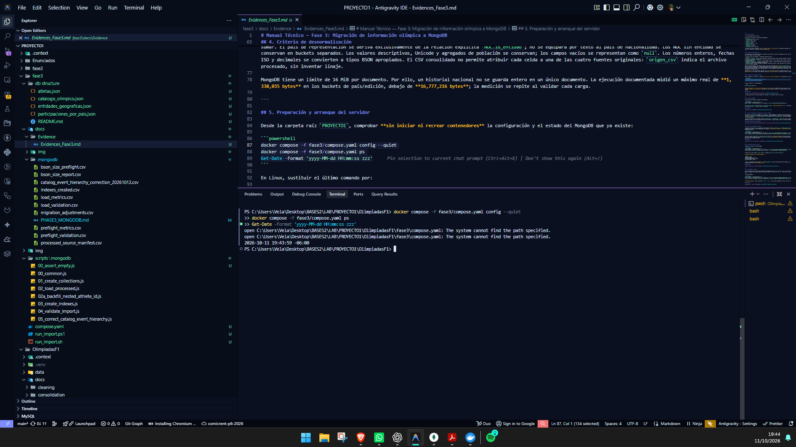

La imagen debe mostrar el nombre de la base, las cuatro colecciones y la fecha/hora real de la máquina.

---

## 6. Conexión a MongoDB

Verificar conexión desde el contenedor de herramientas:

```powershell
Get-Date -Format 'yyyy-MM-dd HH:mm:ss zzz'
mongosh 'mongodb://127.0.0.1:27017/OlimpiadasF3' --quiet --eval 'printjson(db.adminCommand({ping:1}))'
```

En Linux, usar `date '+%Y-%m-%d %H:%M:%S %z'` en vez de `Get-Date`. **Resultado esperado:** `ok: 1`. Para MongoDB Compass, la conexión de la base cargada es `mongodb://127.0.0.1:27017/?directConnection=true` y la base se llama `OlimpiadasF3`.

### Evidencia

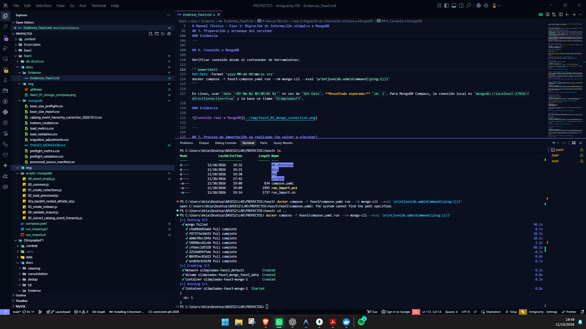

---

## 7. Proceso de importación ya realizado (no volver a ejecutar)

Los archivos `run_import.ps1` (Windows) y `run_import.sh` (Linux) quedan en el proyecto para una instalación **nueva y vacía**, pero **no son comandos de comprobación de la base vigente**. Su flujo crea colecciones, ejecuta preflight, importa documentos, crea índices y valida. No ejecutarlos para tomar capturas de esta base. Tampoco ejecutar `01_create_collections.js`, `02_load_processed.js` con escritura ni `03_create_indexes.js` solo para documentar: los resultados se verifican con consultas de lectura en las secciones siguientes.

La ejecución registrada anteriormente produjo `BASE_VACIA_PASS`, `PREFLIGHT_PASS`, `LOAD_PASS` y 42/42 validaciones. Esos datos son históricos; confirmar el estado actual con los comandos de lectura. Si no se conservó una captura auténtica de la carga original, dejar la evidencia de ejecución como **pendiente**, sin simularla ni recargar por la foto.

### Evidencia histórica de importación

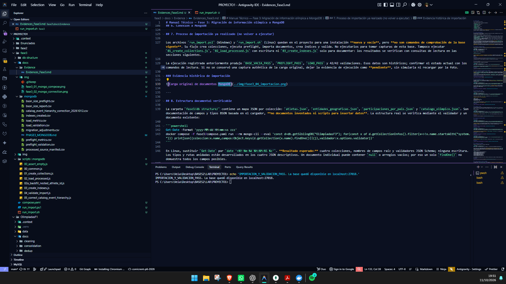

---

## 8. Estructura documental verificable

La carpeta `fase3/db structure/` contiene un mapa JSON por colección: `atletas.json`, `entidades_geograficas.json`, `participaciones_por_pais.json` y `catalogo_olimpico.json`. Son documentación de campos y tipos BSON basada en el cargador, **no documentos inventados ni scripts para insertar datos**. La estructura real se verifica mediante el validador y un documento existente:

```powershell
Get-Date -Format 'yyyy-MM-dd HH:mm:ss zzz'
mongosh 'mongodb://127.0.0.1:27017/OlimpiadasF3' --quiet --eval 'const d=db.getSiblingDB("OlimpiadasF3"); for(const x of d.getCollectionInfos().filter(x=>!x.name.startsWith("system."))) printjson({coleccion:x.name,campos:Object.keys(d.getCollection(x.name).findOne()||{}),validador:x.options.validator})'
```

En Linux, sustituir `Get-Date` por `date '+%Y-%m-%d %H:%M:%S %z'`. **Resultado esperado:** cuatro colecciones, nombres de campos raíz y validadores JSON Schema; ninguna escritura. Los tipos y rutas anidadas están desarrollados en los cuatro JSON descriptivos. Un documento individual puede contener `null` o arreglos vacíos; por eso un solo `findOne()` no demuestra todos los campos posibles.

### Evidencia

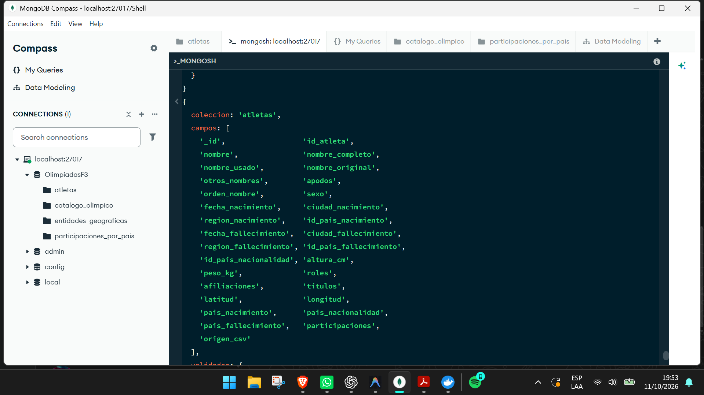

---

## 9. Colecciones creadas y conteos

Comprobar los conteos en la base cargada:

```powershell
Get-Date -Format 'yyyy-MM-dd HH:mm:ss zzz'
mongosh 'mongodb://127.0.0.1:27017/OlimpiadasF3' --quiet --eval 'const d=db.getSiblingDB("OlimpiadasF3"); for(const n of ["atletas","entidades_geograficas","participaciones_por_pais","catalogo_olimpico"]) print(n+" = "+d.getCollection(n).countDocuments({}))'
```

En Bash usar el mismo comando `mongosh` y precederlo con `date '+%Y-%m-%d %H:%M:%S %z'`.

**Resultado esperado de los CSV documentados:**

```text
atletas = 167295
entidades_geograficas = 282
participaciones_por_pais = 4856
catalogo_olimpico = 2590
```

`atletas` anida 367,793 participaciones y `entidades_geograficas` anida 17,024 observaciones de población. Las mismas 367,793 participaciones aparecen como vista de lectura en los buckets de país/NOC; **no sumar ambas copias**.

### Evidencia

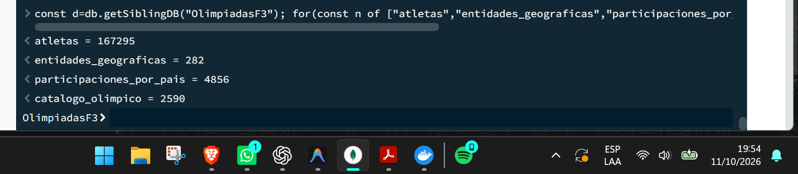

---

## 10. Validadores e índices

Las cuatro colecciones se crearon con validadores JSON Schema en modo `strict` y acción `error`. El script `03_create_indexes.js` creó once índices secundarios para nombres de atleta, entidades, país/edición, medallas y catálogo, además de los cuatro índices `_id_` automáticos. Su definición y justificación están en `fase3/docs/mongodb/indexes_created.csv`.

Verificar metadatos:

```powershell
Get-Date -Format 'yyyy-MM-dd HH:mm:ss zzz'
mongosh 'mongodb://127.0.0.1:27017/OlimpiadasF3' --quiet --eval 'const d=db.getSiblingDB("OlimpiadasF3"); for(const x of d.getCollectionInfos().filter(x=>!x.name.startsWith("system."))) print(x.name+" validador="+x.options.validationLevel+" accion="+x.options.validationAction+" indices="+d.getCollection(x.name).getIndexes().map(i=>i.name).join(","))'
```

**Resultado esperado:** cuatro colecciones, `strict`, `error` y once índices secundarios en total. En Linux, usar `date` antes del mismo comando.

### Evidencia

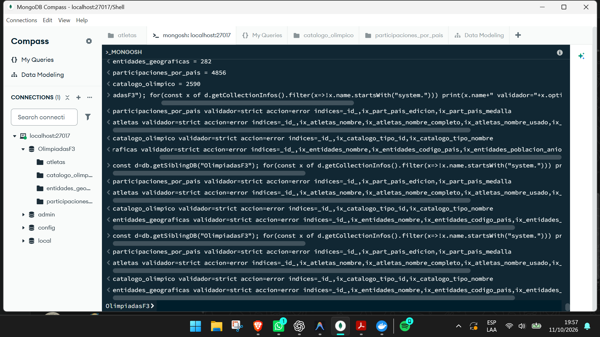

---

## 11. Demostración de documentos anidados

### 11.1 Atleta

```powershell
Get-Date -Format 'yyyy-MM-dd HH:mm:ss zzz'
mongosh 'mongodb://127.0.0.1:27017/OlimpiadasF3' --quiet --eval 'const d=db.getSiblingDB("OlimpiadasF3"); const a=d.atletas.findOne({nombre:"Michael Phelps"}); printjson({id_atleta:a&&a.id_atleta,nombre:a&&a.nombre,participaciones:a&&a.participaciones.length,ejemplo:a&&a.participaciones[0]})'
```

**Resultado esperado:** un solo documento de Michael Phelps, con arreglo de participaciones y un ejemplo que incluye edición, resultado y jerarquía olímpica embebidos. No interpretar la longitud de ese arreglo como medallas sin filtrar y validar la semántica del dato.

### Evidencia

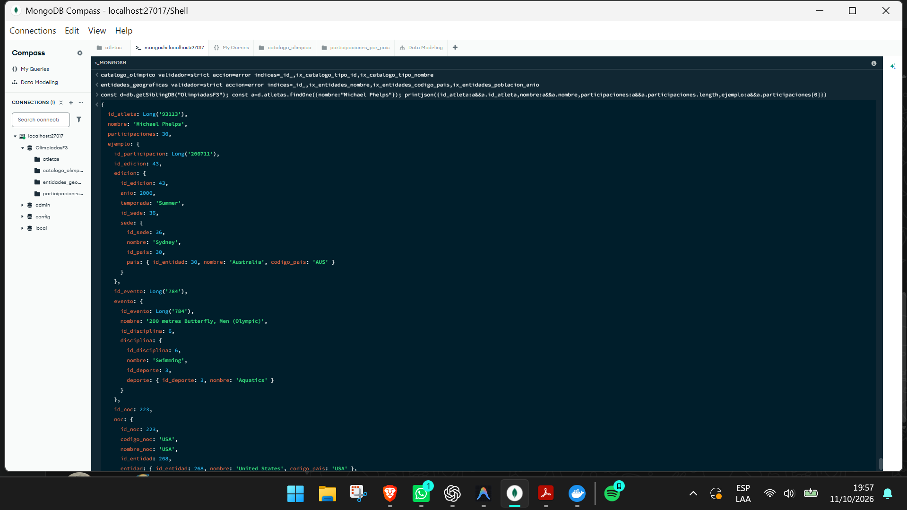

### 11.2 País / entidad

```powershell
Get-Date -Format 'yyyy-MM-dd HH:mm:ss zzz'
mongosh 'mongodb://127.0.0.1:27017/OlimpiadasF3' --quiet --eval 'const d=db.getSiblingDB("OlimpiadasF3"); const g=d.entidades_geograficas.findOne({nombre:"Guatemala"}); printjson({entidad:g&&g.nombre,poblacion_anual:g&&g.poblacion_anual.slice(0,3),nocs:g&&g.nocs,particiones:g?d.participaciones_por_pais.countDocuments({id_entidad:g.id_entidad}):0})'
```

**Resultado esperado en la ejecución documentada:** `entidad: Guatemala`, `particiones: 20`. La ficha del país y sus buckets de participación por edición se leen con índices; no es una colección por tabla relacional.

### Evidencia

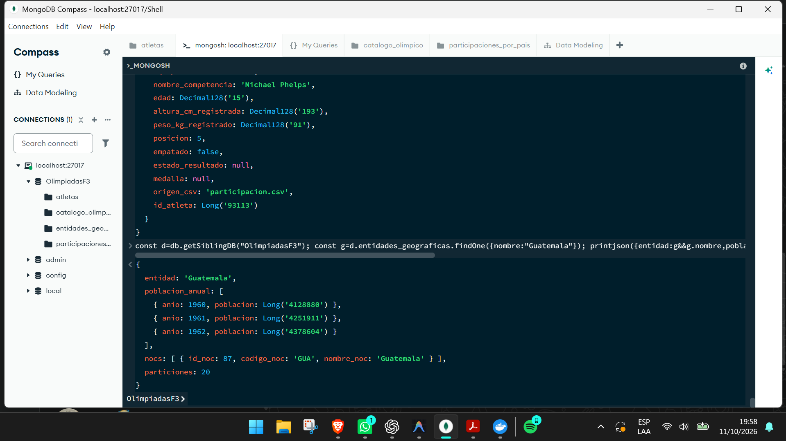

### 11.3 Catálogo olímpico

```powershell
Get-Date -Format 'yyyy-MM-dd HH:mm:ss zzz'
mongosh 'mongodb://127.0.0.1:27017/OlimpiadasF3' --quiet --eval 'const d=db.getSiblingDB("OlimpiadasF3"); const e=d.catalogo_olimpico.findOne({tipo:"EVENTO"}); printjson({tipo:e&&e.tipo,nombre:e&&e.nombre,disciplina:e&&e.disciplina})'
```

**Resultado esperado:** un `EVENTO` con `disciplina` y, dentro de ella, `deporte`. Es una lectura de un registro real; el nombre concreto depende del primer documento devuelto.

### Evidencia

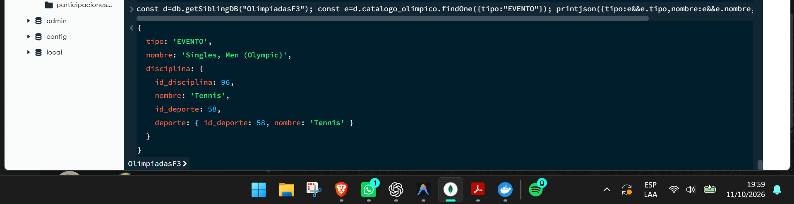

---

## 12. Validación final e integridad

Ejecutar la validación posterior (no vuelve a cargar datos):

```powershell
Get-Date -Format 'yyyy-MM-dd HH:mm:ss zzz'
mongosh 'mongodb://127.0.0.1:27017/OlimpiadasF3' --quiet --file fase3/scripts/mongodb/04_validate_import.js
```

En Linux, usar `date` antes del mismo comando. **Resultado esperado de esta versión de los CSV:** `estado: PASS`, `validaciones: 42`, `fallos: []`, 0 diferencias en campos de atleta, participación y nombres Unicode. El proceso compara ambos accesos a participaciones contra el CSV, verifica SHA-256 de los diez archivos fuente, tipos/relaciones, índices, validadores y tamaño BSON menor de 16 MiB. **No modifica MongoDB**, aunque sí actualiza los reportes de validación y tamaño BSON con la fecha de esta nueva comprobación. Puede tardar varios minutos y no imprimir avances intermedios; esperar el resultado final antes de concluir que no produjo salida.

Reportes complementarios:

```text
fase3/docs/mongodb/processed_source_manifest.csv
fase3/docs/mongodb/preflight_validation.csv
fase3/docs/mongodb/preflight_metrics.csv
fase3/docs/mongodb/bson_size_preflight.csv
fase3/docs/mongodb/load_metrics.csv
fase3/docs/mongodb/indexes_created.csv
fase3/docs/mongodb/load_validation.csv
fase3/docs/mongodb/bson_size_report.csv
```

Los timestamps de los reportes están en UTC y reflejan la ejecución que los produjo. No deben presentarse como fecha/hora de otra computadora o corrida.

### Evidencia

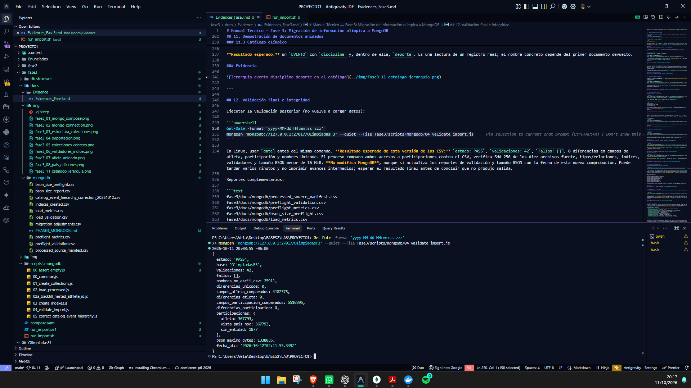

---

## 13. Disponibilidad de la base vigente

La base poblada está en el servidor de `127.0.0.1:27017`. Para comprobar que sigue accesible, sin parar ni recrear su servicio:

```powershell
Get-Date -Format 'yyyy-MM-dd HH:mm:ss zzz'
mongosh 'mongodb://127.0.0.1:27017/OlimpiadasF3' --quiet --eval 'printjson({base:db.getName(),atletas:db.atletas.countDocuments({}),colecciones:db.getCollectionNames().length})'
```

**Resultado esperado:** `OlimpiadasF3`, `167295` atletas y cuatro colecciones. En Linux sustituir `Get-Date` por `date '+%Y-%m-%d %H:%M:%S %z'`. Esta lectura demuestra disponibilidad actual, **no persistencia tras recreación**. El volumen `mongo_fase3_data` del Compose nuevo pertenece a la instancia separada de `27018` y no debe presentarse como prueba de persistencia de la base cargada de `27017`. La prueba de persistencia de esa instancia queda pendiente de conocer y documentar cómo está instalada, sin reiniciarla aquí.

### Evidencia

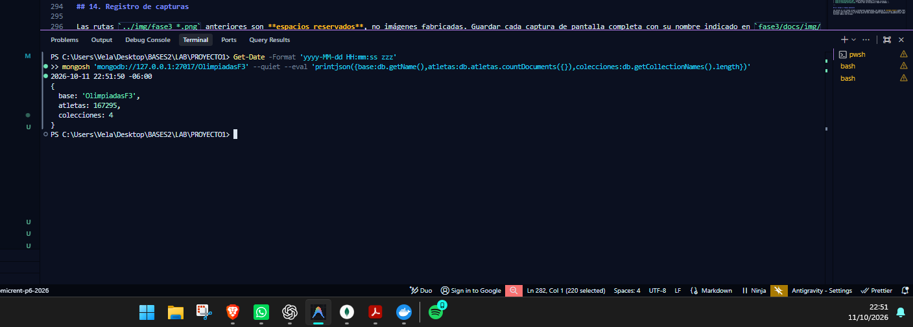

---
