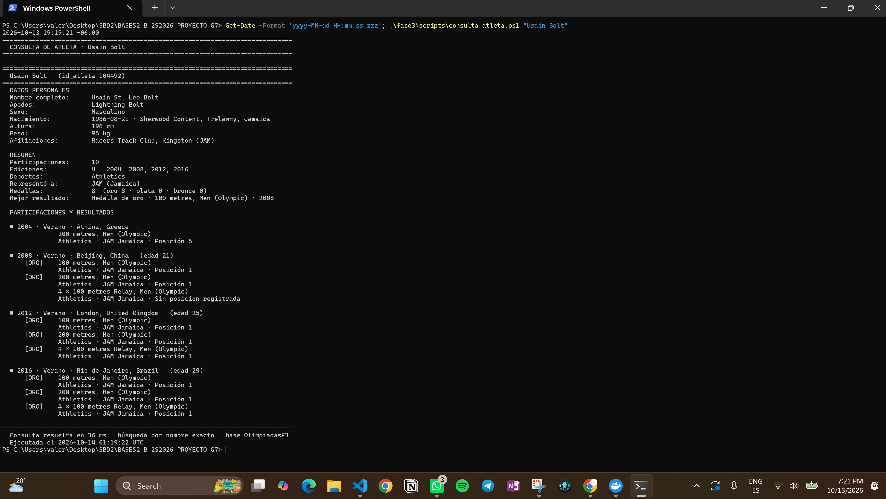
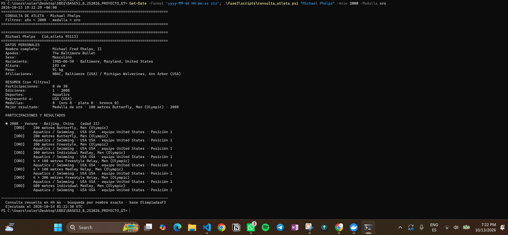
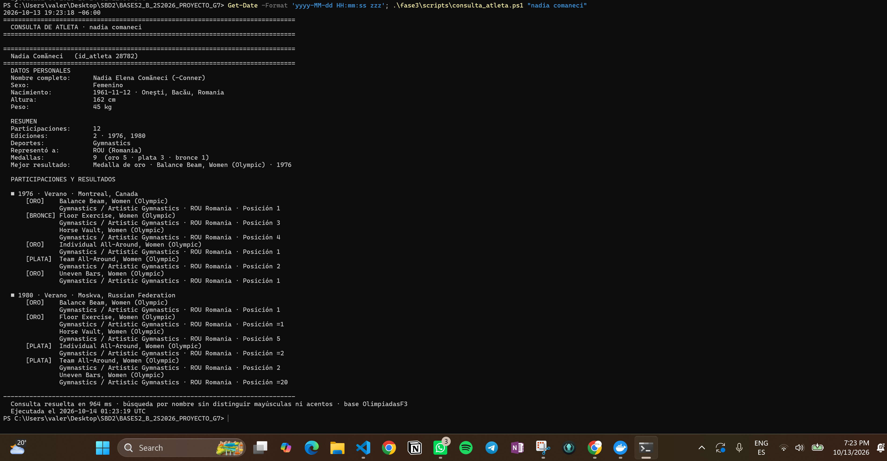
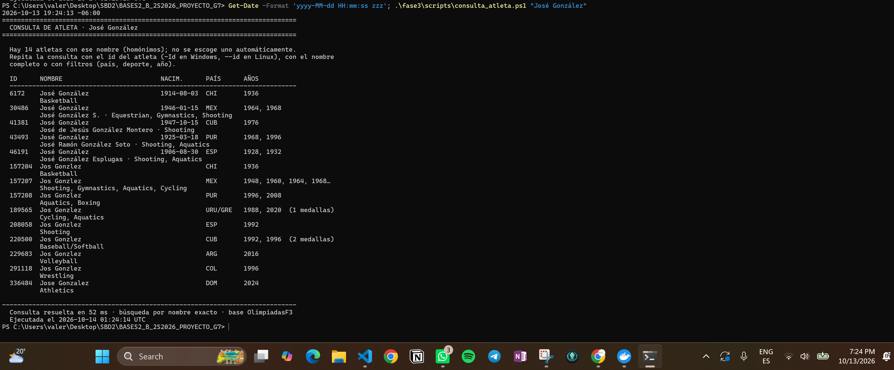
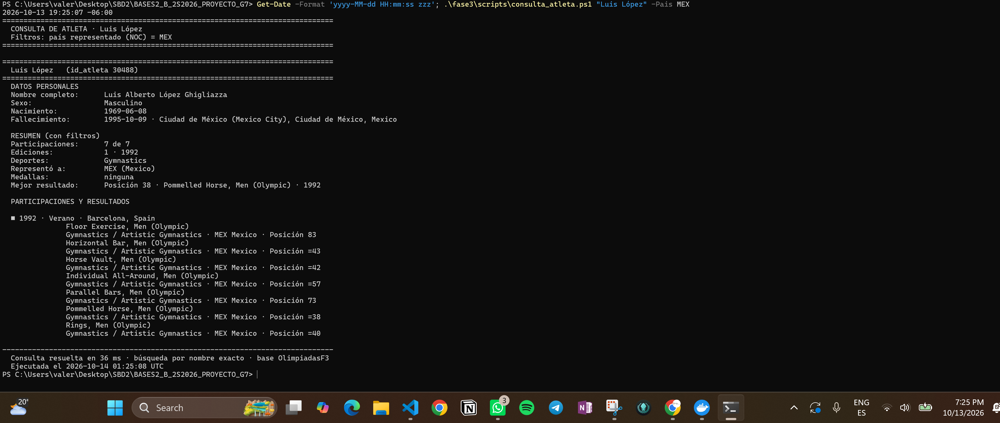
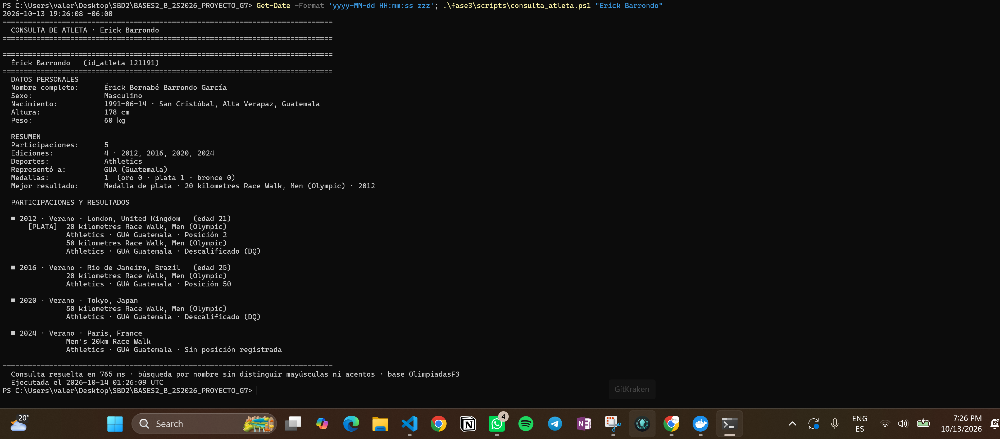
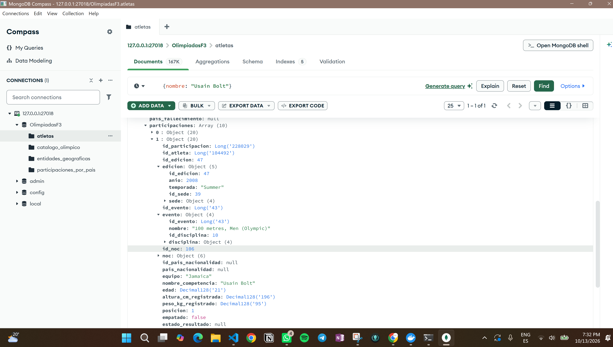
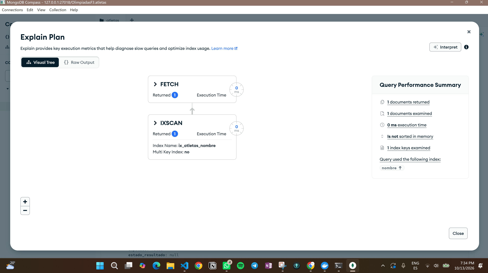

# Fase 3 — Inciso c: consulta de atleta

**Proyecto:** OlimpiadasF1 · Grupo 7
**Base MongoDB:** `OlimpiadasF3` (cargada con los scripts 01–04 de los incisos a y b)
**Responsable:** Valery Alarcón
**Ejecución de las evidencias:** 13 de octubre de 2026 · MongoDB 8.0 de `fase3/compose.yaml`, cargado con `run_import.ps1` (42/42 validaciones PASS)

> Enunciado: *Realizar un método/script que reciba como primer parámetro el nombre del atleta y que despliegue toda la información relacionada con el mismo, participaciones, resultados, medallas, el formato de salida es a su criterio. Pueden agregar parámetros para mostrar o filtrar información específica, por ejemplo, deporte, país y año.*

## Archivos

| Archivo | Función |
|---|---|
| `fase3/scripts/mongodb/06_consulta_atleta.js` | La consulta, en mongosh. Lee los parámetros de variables de entorno, igual que los scripts 01–05. |
| `fase3/scripts/consulta_atleta.ps1` | Comando para Windows (PowerShell). |
| `fase3/scripts/consulta_atleta.sh` | Comando para Linux/macOS (y Git Bash en Windows). |
| `fase3/docs/inciso_c/evidencia/` | Salidas reales de las consultas de prueba, con fecha y hora de ejecución, y la medición con `explain`. |

El script **solo lee**: no importa datos, no crea índices y no modifica colecciones ni CSV. Usa los índices de nombre de `03_create_indexes.js`, de modo que `04_validate_import.js` sigue encontrando exactamente los 11 índices esperados.

## Conexión

| Situación | Qué hace el comando |
|---|---|
| `mongosh` instalado | Se conecta a `mongodb://127.0.0.1:27017` (la base documentada en `PHASE3_MONGODB.md`). Para la instancia de `fase3/compose.yaml`, agregar `-Uri mongodb://127.0.0.1:27018` (`--uri` en Linux). |
| Sin `mongosh`, con Docker | Ejecuta `mongosh` dentro del contenedor MongoDB de `fase3/compose.yaml` (lo localiza con `docker compose ps`). Si no está en ejecución, indica iniciarlo con `run_import`. Con `-Contenedor` se puede elegir otro contenedor. |

## Uso

El primer parámetro es siempre el nombre del atleta.

**Windows**

```powershell
.\fase3\scripts\consulta_atleta.ps1 "Usain Bolt"
.\fase3\scripts\consulta_atleta.ps1 "Michael Phelps" -Anio 2008 -Medalla oro
.\fase3\scripts\consulta_atleta.ps1 "Luis López" -Pais MEX
.\fase3\scripts\consulta_atleta.ps1 -Id 93113 -Deporte Swimming
.\fase3\scripts\consulta_atleta.ps1 "Usain Bolt" -Formato json
```

**Linux**

```bash
./fase3/scripts/consulta_atleta.sh "Usain Bolt"
./fase3/scripts/consulta_atleta.sh "Michael Phelps" --anio 2008 --medalla oro
./fase3/scripts/consulta_atleta.sh "Luis López" --pais MEX
./fase3/scripts/consulta_atleta.sh --id 93113 --deporte Swimming
./fase3/scripts/consulta_atleta.sh "Usain Bolt" --json
```

### Parámetros

| Windows | Linux | Valores | Descripción |
|---|---|---|---|
| *(1.º)* | *(1.º)* | texto, 2 a 150 caracteres | Nombre del atleta. Obligatorio, salvo que se use el id. |
| `-Deporte` | `--deporte` | texto | Deporte o disciplina, coincidencia parcial (`Swimming`, `Athletics`). |
| `-Pais` | `--pais` | código o texto | **País representado (NOC) en cada participación**: código exacto (`GUA`, `JAM`) o parte del nombre (`Guatemala`). No filtra por nacionalidad. |
| `-Anio` | `--anio` | cuatro dígitos | Año de la edición (`2008`). |
| `-Temporada` | `--temporada` | `verano`, `invierno` o valor de la fuente | `Summer`, `Winter`, `Summer Youth`, `Winter Youth`, `Intercalated Games`. |
| `-Medalla` | `--medalla` | `oro`, `plata`, `bronce`, `cualquiera` | Medalla de la participación. |
| `-Id` | `--id` | número | `id_atleta` exacto, para elegir entre homónimos. |
| `-Formato json` | `--json` | | Salida en JSON en lugar de texto. |
| `-Uri`, `-BaseDatos`, `-Contenedor` | `--uri`, `--db`, `--contenedor` | | Conexión (ver la sección anterior). |

Los filtros se combinan: todas las condiciones deben cumplirse **en la misma participación**. Un valor inválido (año de tres dígitos, medalla desconocida, nombre de una letra) produce un mensaje legible y código de salida 1, sin traza técnica.

Los nombres de deportes, eventos y temporadas están en inglés, como en las fuentes. Si los filtros dejan fuera todas las participaciones de un atleta que sí existe, la salida lista sus años, temporadas, deportes, países y medallas para corregir la consulta.

## Qué muestra

1. **Datos personales:** nombre completo, otros nombres, apodos, sexo, fecha y lugar de nacimiento y fallecimiento, nacionalidad, altura, peso, afiliaciones y títulos. Solo se muestran los campos con dato; un `null` se trata como no informado y no se completa por suposición.
2. **Resumen:** participaciones (con filtros, `mostradas de totales`), ediciones y años, deportes, países representados (NOC), medallero (oro, plata, bronce y total) y mejor resultado.
3. **Participaciones y resultados**, agrupados por edición (año, temporada, sede y edad): evento, deporte/disciplina, NOC, equipo, posición (`=5` si fue empate) o estado (no terminó, no se presentó, descalificado) y medalla. Si la edición no tiene sede en los datos, se indica "sede no informada".

Reglas de cálculo:

- Todo se calcula desde un único documento de `atletas`; **nunca** se suman las copias de `participaciones_por_pais`, que representan los mismos `id_participacion`.
- Las medallas se cuentan solo desde el campo `medalla` (Gold, Silver, Bronze). Una `posicion = 1` sin medalla no cuenta como oro, y una fila `DQ` no cuenta como medalla.
- Los totales se calculan sobre el conjunto filtrado completo; no hay paginación.
- Orden determinístico de participaciones: año, edición, evento e `id_participacion`.
- Los nombres se muestran tal como están almacenados (Unicode exacto).

## Búsqueda por nombre

1. **Exacta, con índice.** Busca el nombre en `nombre`, `nombre_completo` y `nombre_usado` en tres formas: como se escribió, sin acentos y sin las letras acentuadas. La tercera forma recupera registros cuyas fuentes perdieron esos caracteres: `"José González"` también encuentra `"Jos Gonzlez"`, después de los que coinciden tal como se escribió.
2. **Sin distinguir mayúsculas ni acentos.** Si no hubo coincidencia exacta, una sola pasada exige todas las palabras escritas en algún campo de nombre. Si alguna coincide con el nombre completo (`"nadia comaneci"` → `"Nadia Comăneci"`), se usa esa; si no, es una coincidencia parcial. Cubre acentos del español, francés, portugués, Europa del Este y turco. Lo escrito se escapa antes de armar la expresión regular.
3. **Nunca se escoge un atleta arbitrariamente.** Si queda un solo atleta, se muestra completo. Si quedan varios (homónimos o coincidencia parcial), se lista una tabla de candidatos (los primeros 25) con id, nombre, nombre completo, nacimiento, país, años, deportes y medallas, para repetir la consulta con `-Id`, con el nombre completo o con filtros. No se fusionan identidades por similitud de nombre. La búsqueda parcial lee como máximo 1,000 coincidencias e indica "más de 1000" si hay más.

Los filtros se aplican dentro de la consulta a MongoDB (`$elemMatch` sobre `participaciones`), así que también distinguen homónimos: entre los 9 `"Luis López"`, `-Pais MEX` deja solo al gimnasta mexicano.

## Índices y tiempos medidos

Medición con `explain("executionStats")` (evidencia `11_explain_execution_stats.txt`):

| Consulta | Resultados | Claves examinadas | Documentos examinados | Tiempo en MongoDB | Índices |
|---|---:|---:|---:|---:|---|
| Nombre exacto `"Michael Phelps"` | 1 | 1 | 1 | 0 ms | `ix_atletas_nombre`, `ix_atletas_nombre_completo`, `ix_atletas_nombre_usado` |
| Nombre exacto + año 2008 + oro | 1 | 1 | 1 | 0 ms | los mismos |
| Parcial `"phelps"` | 12 | 454,829 | 12 | 527 ms | los mismos |

La búsqueda exacta llega directo al documento por índice. La búsqueda sin acentos o parcial no puede aprovechar el orden del índice (una expresión regular sin ancla), así que recorre todas las claves de los tres índices de nombre, pero solo lee los documentos que coinciden; por eso responde en alrededor de medio segundo y no en varios.

Tiempo total que imprime el script (incluye armar la salida, sin contar el arranque de mongosh), en las evidencias del 13/10/2026:

| Caso | Ejemplo | Tiempo |
|---|---|---:|
| Nombre exacto | `"Usain Bolt"` | 27 ms |
| Nombre exacto con filtros | `"Michael Phelps" -Anio 2008 -Medalla oro` | 28 ms |
| Homónimos | `"José González"` (14 candidatos) | 41 ms |
| Sin mayúsculas ni acentos | `"nadia comaneci"` | 524 ms |
| Coincidencia parcial | `"phelps"` (12 candidatos) | 533 ms |
| Inexistente | `"Fulano Inexistente"` | 491 ms |

Son observaciones de esta instalación, no una garantía de tiempo fijo.

## Pruebas de aceptación

| Prueba (de `context_inciso_c.md`) | Resultado | Evidencia |
|---|---|---|
| `Michael Phelps` resuelve un documento con 30 filas de participación y desglose de medallas | 30 participaciones; 28 medallas: 23 oro, 3 plata, 2 bronce | consulta en vivo / `02` |
| Búsqueda inexistente: mensaje comprensible, sin error técnico | "No se encontró ningún atleta con ese nombre." | `09_atleta_inexistente.txt` |
| Nombre ambiguo: candidatos, sin unión automática | 14 candidatos para "José González" | `06_homonimos_jose_gonzalez.txt` |
| Filtro por año/deporte: cada fila cumple y los totales concuerdan | Phelps 2008 + oro: 8 de 30, todas de 2008 y oro; total 8 | `02_phelps_2008_oro.txt` |
| Nombre con caracteres no ASCII conserva el Unicode | `Comăneci`, `Onești, Bacău`, `Érick` | `03`, `04` |
| Medición con `explain("executionStats")` | Ver la tabla anterior | `11_explain_execution_stats.txt` |

## Evidencias

Cada archivo de `fase3/docs/inciso_c/evidencia/` contiene el comando ejecutado y su salida completa, que termina con la fecha y hora de ejecución en UTC.

| Archivo | Qué demuestra |
|---|---|
| `01_usain_bolt.txt` | Consulta completa: 10 participaciones en 4 ediciones, 8 oros. El relevo 4×100 de 2008 aparece sin medalla porque fue retirada (descalificación de Nesta Carter en 2017). |
| `02_phelps_2008_oro.txt` | Filtros combinados de año y medalla: los 8 oros de Beijing 2008 (8 de 30 participaciones). |
| `03_comaneci_sin_acentos.txt` | Búsqueda sin acentos ni mayúsculas (`ă` rumana). |
| `04_erick_barrondo_guatemala.txt` | Atleta guatemalteco: plata de 2012 y descalificación (DQ) en los 50 km. |
| `05_busqueda_parcial_phelps.txt` | Candidatos ante una búsqueda parcial. |
| `06_homonimos_jose_gonzalez.txt` | Homónimos, incluidos los registros sin letras acentuadas; no se escoge uno. |
| `07_homonimos_filtro_pais.txt` | Filtro por país representado para distinguir homónimos. |
| `08_filtro_sin_resultados.txt` | Ayuda cuando los filtros no coinciden (deporte escrito en español). |
| `09_atleta_inexistente.txt` | Mensaje para un nombre que no existe. |
| `10_usain_bolt_2016_json.json` | Salida en formato JSON. |
| `11_explain_execution_stats.txt` | Claves y documentos examinados, e índices usados. |

### Capturas

Ejecutar cada bloque en PowerShell desde la carpeta raíz del proyecto, con `Get-Date` visible en la captura, y guardar la imagen con el nombre indicado en `fase3/docs/img/`.

| Imagen | Comandos |
|---|---|
| `inciso_c_01_usain_bolt.png` | `Get-Date -Format 'yyyy-MM-dd HH:mm:ss zzz'` y `.\fase3\scripts\consulta_atleta.ps1 "Usain Bolt"` |
| `inciso_c_02_filtros.png` | `Get-Date ...` y `.\fase3\scripts\consulta_atleta.ps1 "Michael Phelps" -Anio 2008 -Medalla oro` |
| `inciso_c_03_sin_acentos.png` | `Get-Date ...` y `.\fase3\scripts\consulta_atleta.ps1 "nadia comaneci"` |
| `inciso_c_04_homonimos.png` | `Get-Date ...` y `.\fase3\scripts\consulta_atleta.ps1 "José González"` |
| `inciso_c_05_homonimo_resuelto.png` | `Get-Date ...` y `.\fase3\scripts\consulta_atleta.ps1 "Luis López" -Pais MEX` |
| `inciso_c_06_guatemala.png` | `Get-Date ...` y `.\fase3\scripts\consulta_atleta.ps1 "Erick Barrondo"` |
| `inciso_c_07_compass_documento.png` | MongoDB Compass, colección `atletas`, pestaña *Documents*, filtro `{ nombre: "Usain Bolt" }`: el documento que lee el script, con sus participaciones anidadas. |
| `inciso_c_08_compass_explain.png` | MongoDB Compass, misma consulta, botón *Explain*: plan con `IXSCAN` sobre `ix_atletas_nombre`, 1 clave y 1 documento examinados. |

Las capturas 07 y 08 complementan a las del script: este no se ejecuta dentro de Compass porque recibe el nombre como parámetro de línea de comandos. En ellas la fecha y hora se toman del reloj de la barra de tareas.

















## Observaciones sobre los datos

- Hay 1,575 nombres compartidos por más de un atleta; por eso existen el parámetro de id y la tabla de candidatos.
- Algunos nombres perdieron las letras acentuadas en su fuente (`"Jos Gonzlez"`). No se corrigieron aquí porque el inciso c solo lee; la búsqueda los recupera como se describe arriba.
