# Fase 3 — Inciso d: consulta histórica por país

**Proyecto:** OlimpiadasF1 · Grupo 7  
**Base MongoDB:** `OlimpiadasF3` (instancia en `fase3/compose.yaml` cargada y validada con 42/42 pruebas PASS)  
**Responsable:** Gahel / Helado  
**Ejecución de las evidencias:** 21 de octubre de 2026 · MongoDB 8.0  

> **Enunciado oficial:**  
> *Realizar un método/script que reciba de parámetro el país y que despliegue toda la información relacionada con el mismo, participaciones, información de medallas, resultados, año de participación, si ha sido sede en alguna ocasión y que años. El formato de salida es a su criterio. Pueden agregar parámetros para filtrar información específica.*

---

## 1. Archivos entregados

| Archivo | Ubicación | Descripción |
|---|---|---|
| `07_consulta_pais.js` | `fase3/scripts/mongodb/` | Script central en JavaScript para `mongosh`. Define la función `consultaPais(pais, opciones)`, que resuelve la entidad, ejecuta la consulta indexada a los buckets de país, calcula el doble medallero (país vs. atletas) y genera la salida. Desde la terminal recibe los parámetros por variables de entorno y se ejecuta sola; en la consola de mongosh o de Compass se pega el archivo y se llama la función. |
| `consulta_pais.ps1` | `fase3/scripts/` | Envoltorio en PowerShell para Windows (codificado en UTF-8 con BOM). Detecta si `mongosh` está en el sistema o ejecuta vía contenedor Docker de `fase3/compose.yaml`. |
| `consulta_pais.sh` | `fase3/scripts/` | Envoltorio en Bash para Linux, macOS y Git Bash en Windows. |
| `INCISO_D_CONSULTA_PAIS.md` | `fase3/docs/inciso_d/` | Este documento técnico de especificación, arquitectura y evidencias. |
| Banco de evidencias (`.txt`, `.json`) | `fase3/docs/inciso_d/evidencia/` | Salidas completas de 11 pruebas reales con fecha, hora UTC y métricas. |
| Capturas de terminal (`.png`) | `fase3/docs/img/` | Capturas de pantalla reales con fecha y hora del sistema operativo visible. |

El script es de **solo lectura**: no inserta, no modifica colecciones ni altera los CSVs procesados. Utiliza estrictamente los índices analíticos creados en `03_create_indexes.js`.

---

## 2. Conexión y ejecución

| Situación | Comportamiento del script |
|---|---|
| Con `mongosh` instalado en el host | Se conecta a `mongodb://127.0.0.1:27018` (puerto expuesto por `fase3/compose.yaml`). Si se usa una base nativa en el puerto estándar 27017, se especifica con `-Uri mongodb://127.0.0.1:27017` (`--uri` en Linux). |
| Sin `mongosh` en el host (con Docker) | El envoltorio detecta el contenedor de MongoDB (`olimpiadas-fase3-mongo-1`), copia el script a `/tmp/07_consulta_pais.js` y lo ejecuta con `docker exec`, transfiriendo los parámetros por variables de entorno. |

---

## 3. Modo de uso

El primer parámetro obligatorio es el país (nombre, código NOC o código ISO3):

### Windows (PowerShell)

```powershell
# Búsqueda por nombre o código NOC
.\fase3\scripts\consulta_pais.ps1 "Guatemala"
.\fase3\scripts\consulta_pais.ps1 GUA -Medalla cualquiera

# Filtros combinados de año, temporada, deporte o medalla
.\fase3\scripts\consulta_pais.ps1 "France" -Anio 2024 -Medalla oro
.\fase3\scripts\consulta_pais.ps1 "Argentina" -Deporte Football
.\fase3\scripts\consulta_pais.ps1 "peru" -Medalla cualquiera

# Manejo de límite de filas y formato JSON
.\fase3\scripts\consulta_pais.ps1 USA -Anio 2016 -Limite 50
.\fase3\scripts\consulta_pais.ps1 GUA -Medalla cualquiera -Formato json
```

### Linux / macOS (Bash)

```bash
./fase3/scripts/consulta_pais.sh "Guatemala"
./fase3/scripts/consulta_pais.sh GUA --medalla cualquiera
./fase3/scripts/consulta_pais.sh "France" --anio 2024 --medalla oro
./fase3/scripts/consulta_pais.sh "Argentina" --deporte Football
./fase3/scripts/consulta_pais.sh GUA --json
```

### Consola de mongosh o MongoDB Compass

Conectado a la base (en Compass: **Open MongoDB shell**), se pega el contenido completo de `07_consulta_pais.js`. Al pegarlo solo queda definida la función, que se llama con el país y un objeto de opciones con los mismos filtros, en minúsculas (`anio`, `temporada`, `deporte`, `medalla`, `limite`, `formato`):

```javascript
consultaPais("Guatemala")
consultaPais("GUA", { medalla: "cualquiera" })
consultaPais("France", { anio: 2024, temporada: "verano", medalla: "oro" })
consultaPais("Argentina", { deporte: "Football", limite: "todos" })
```

Los casos que terminan antes (país ambiguo, inexistente o salida JSON) cierran la consulta sin cerrar la consola, y un valor inválido lanza un error con el mismo mensaje que en la terminal.

---

## 4. Parámetros soportados

| Parámetro (PowerShell) | Opción (Bash) | Valores permitidos | Descripción |
|---|---|---|---|
| *(Posición 0)* | *(Posición 0)* | Texto (`"Guatemala"`, `GUA`, `FRA`, `ARG`, `PER`) | **Obligatorio.** Nombre del país, código olímpico NOC o código ISO3. Insensible a mayúsculas y acentos. |
| `-Anio` | `--anio` | Cuatro dígitos (`2012`, `2024`) | Filtra participaciones únicamente para el año de la edición olímpica. |
| `-Temporada` | `--temporada` | `verano`, `invierno`, `Summer`, `Winter`, etc. | Filtra por temporada olímpica. |
| `-Deporte` | `--deporte` | Texto parcial (`Football`, `Athletics`, `Shooting`) | Coincidencia parcial insensible a mayúsculas sobre el nombre del deporte o disciplina. |
| `-Medalla` | `--medalla` | `oro`, `plata`, `bronce`, `cualquiera` (o `todas`) | Filtra participaciones con medalla obtenida. |
| `-Limite` | `--limite` | Número (`50`, `100`) o `todos` (predeterminado: `100`) | Controla la cantidad máxima de filas de detalle a imprimir en pantalla para evitar desbordar la terminal en países masivos. |
| `-Formato` | `--json` | `texto` (predeterminado) o `json` | Define la estructura de salida. |
| `-Uri`, `-BaseDatos`, `-Contenedor` | `--uri`, `--db`, `--contenedor` | Parámetros de red | Permite apuntar a instancias alternativas de MongoDB o contenedores específicos. |

---

## 5. Información que despliega la consulta

La salida está organizada en bloques lógicos claramente delimitados:

1. **Datos generales y geográficos:**
   * Nombre oficial de la entidad geográfica.
   * Código ISO3 de país registrado (ej. `GTM`, `FRA`, `ARG`).
   * Códigos de Comités Olímpicos Nacionales (NOC) vinculados a la entidad.
   * Serie temporal y último dato disponible de **población anual** registrada en las fuentes oficiales (ej. `17,602,431 hab. (año 2023)` para Guatemala).
   * Alerta explícita si la entidad corresponde a un **agregado estadístico/regional** sin representación olímpica independiente (ej. `World`, `Latin America & Caribbean`).
2. **Historial como sede / anfitrión olímpico (Requisito explícito del enunciado):**
   * Indica si el país ha sido sede olímpica en alguna ocasión.
   * Si ha sido anfitrión, lista cronológicamente cada una de las ediciones organizadas con su **año**, **temporada** y **ciudad sede** (ej. Francia: París 1900 Verano, París 1924 Verano, Chamonix 1924 Invierno, Grenoble 1968 Invierno, Albertville 1992 Invierno, París 2024 Verano).
   * Si no ha sido sede, muestra explícitamente: *"Sedes y ediciones organizadas: Ninguna (el país no ha sido sede en las ediciones registradas)"*.
3. **Resumen histórico olímpico:**
   * Total de participaciones del país (con desglose de mostradas vs. totales si se aplicaron filtros o límite).
   * Cantidad de **atletas únicos** que compitieron representando al país (desduplicados por ID de atleta).
   * Cantidad y lista de años de las ediciones en las que tuvo delegación presente.
   * Lista de deportes disputados.
4. **Medallero olímpico (Doble conteo con justificación técnica):**
   * **Medallero oficial del país (por prueba):** Cumple con la *Regla de Oro 2.1* del catedrático y las pautas de `context_inciso_d.md`. En pruebas colectivas o de equipo (fútbol, relevos 4×100m, rugby, vóleibol), un podio ganado por el equipo cuenta como **1 medalla oficial para el país**.
   * **Medallas físicas acumuladas por atletas:** Suma todas las medallas individuales recibidas en el podio por los deportistas integrantes.
   * El script explica la diferencia automáticamente cuando se detectan eventos de equipo.
5. **Detalle de participaciones y resultados:**
   * Agrupado cronológicamente por edición: `Año · Temporada · Sede`.
   * Para cada participación se muestra:
     * Etiqueta destacada de podio: `[ORO]`, `[PLATA]`, `[BRONCE]`.
     * Nombre completo del evento disputado.
     * Deporte y disciplina.
     * Nombre completo del atleta y su `id_atleta` trazable.
     * Posición obtenida (con aviso de `empate`) o estado de resultado oficial (`DQ` Descalificado, `DNF` No terminó, `DNS` No se presentó).
6. **Pie de auditoría y rendimiento:**
   * Tiempo de respuesta de la consulta medido en milisegundos.
   * Método de resolución de búsqueda utilizado (por código NOC, código ISO3 o nombre).
   * Fecha y hora exacta de ejecución en formato UTC.

---

## 6. Decisiones semánticas y calidad de datos

1. **Asociación de país por delegación olímpica (NOC):**
   El país de representación olímpica proviene de `NOC.id_entidad`, no de la nacionalidad o lugar de nacimiento del atleta. Si un atleta de origen extranjero compitió bajo la bandera de Guatemala (NOC `GUA`), su participación computa legítimamente para la delegación guatemalteca.
2. **Diferenciación estricta entre participaciones y atletas únicos:**
   Un atleta puede competir en múltiples eventos de una misma edición o a lo largo de varias olimpiadas. El resumen contabiliza el conteo de filas de participación y, de forma separada mediante un conjunto (`Set`), el total de identidades únicas (`id_atleta`).
3. **Manejo de agregados estadísticos sin comités olímpicos:**
   Entidades como `"World"` o `"Euro area"` provienen del cruce del Banco Mundial y están en `entidades_geograficas` para conservar la serie de población. El script las identifica porque no poseen registros en `nocs[]` ni buckets de participación, mostrando una advertencia informativa en lugar de fallar o inventar participaciones.
4. **Búsqueda por código de 3 letras priorizada:**
   Si el usuario escribe 3 letras (ej. `GUA`, `FRA`, `ARG`), el script busca primero por coincidencia exacta en `nocs.codigo_noc` y luego en `codigo_pais` (ISO3). Esto garantiza que `GUA` resuelva de inmediato a Guatemala (`id_entidad: 109`) en menos de 50 ms.
5. **Manejo de acentos y homónimos:**
   La búsqueda por nombre normaliza tildes y caracteres diacríticos (`"peru"` o `"Perú"`, `"mexico"` o `"México"`). Si un término es ambiguo (ej. `"United"`), se despliega una tabla con los candidatos disponibles para que el evaluador elija sin que el sistema tome decisiones arbitrarias.

---

## 7. Índices y tiempos medidos

La arquitectura NoSQL utiliza **dos lecturas indexadas**, evitando escaneos secuenciales (`COLLSCAN`) sobre las colecciones principales:

1. `ix_entidades_nombre` o `ix_entidades_codigo_pais` en `entidades_geograficas` para obtener la ficha de la entidad.
2. `ix_part_pais_edicion` (`id_entidad`, `anio`, `temporada`) en `participaciones_por_pais` para cargar los buckets de edición correspondientes.
3. `ix_part_pais_medalla` (`id_entidad`, `participaciones.medalla`) cuando se aplica filtro por medalla.

### Medición oficial con `explain("executionStats")` (Evidencia `11_explain_execution_stats.txt`)

| Operación analizada | Claves examinadas | Documentos examinados | Documentos retornados | Tiempo MongoDB | Índice utilizado |
|---|---:|---:|---:|---:|---|
| Entidad por nombre exacto `"Guatemala"` | 1 | 1 | 1 | **0 ms** | `ix_entidades_nombre` |
| Buckets de Guatemala en edición 2012 | 1 | 1 | 1 | **0 ms** | `ix_part_pais_edicion` |
| Buckets de Guatemala con medalla | 4 | 2 | 2 | **0 ms** | `ix_part_pais_medalla` |
| Entidad por código NOC (282 docs en memoria) | 0 | 282 | 1 | **7 ms** | Colección en RAM |

### Tiempos totales del comando (Envoltorio + renderizado + ejecución)

| Caso de prueba | Comando ejecutado | Tiempo total | Método de búsqueda |
|---|---|---:|---|
| Guatemala completo | `consulta_pais.ps1 "Guatemala"` | **151 ms** | Nombre exacto (`ix_entidades_nombre`) |
| Guatemala con filtro de medallas | `consulta_pais.ps1 GUA -Medalla cualquiera` | **58 ms** | Código NOC (`ix_part_pais_medalla`) |
| Francia sedes y oros 2024 | `consulta_pais.ps1 "France" -Anio 2024 -Medalla oro` | **50 ms** | Nombre exacto + filtros indexados |
| Argentina fútbol | `consulta_pais.ps1 "Argentina" -Deporte Football` | **255 ms** | Nombre exacto + predicado deporte |
| Búsqueda sin acentos (Perú) | `consulta_pais.ps1 "peru" -Medalla cualquiera` | **49 ms** | Normalización fonética / diacríticos |
| Agregado estadístico (World) | `consulta_pais.ps1 "World"` | **44 ms** | Nombre exacto |
| Ambigüedad (United) | `consulta_pais.ps1 "United"` | **38 ms** | Búsqueda con candidatos |
| País inexistente | `consulta_pais.ps1 "Atlantis"` | **32 ms** | Manejo de excepción controlado |
| Guatemala en formato JSON | `consulta_pais.ps1 GUA -Medalla cualquiera -Formato json` | **40 ms** | Serialización JSON directa |

Todos los tiempos están ampliamente por debajo de los límites exigidos para calificación en vivo interactiva.

---

## 8. Verificación de aceptación

| Prueba sugerida | Criterio de éxito | Resultado obtenido | Evidencia |
|---|---|---|---|
| **Guatemala (`GUA`)** | Debe mostrar NOC `GUA`, 20 buckets por edición, 3 medallas olímpicas históricas (1 oro, 1 plata, 1 bronce). | 20 buckets, 591 participaciones, 263 atletas únicos. Medallas: Érick Barrondo (Plata 2012), Adriana Ruano (Oro 2024) y Jean-Pierre Brol (Bronce 2024). | `01`, `02`, `10` |
| **País con sedes conocidas (`France`)** | Debe mostrar las sedes y años organizados sin recorrer manualmente otras colecciones. | 6 ediciones como sede (París 1900, 1924, 2024; Chamonix 1924; Grenoble 1968; Albertville 1992). | `03` |
| **Doble conteo de medallas en deportes colectivos** | En eventos de equipo, debe diferenciar 1 medalla para el país vs. medallas por atleta. | Francia 2024: 16 oros oficiales de país vs. 53 oros de atletas (por Rugby, Vóleibol y Judo Mixto). | `03` |
| **Argentina Fútbol** | Debe listar participaciones y podios históricos de la selección argentina. | 233 participaciones; podios: Atlanta 1996 (Plata) y Atenas 2004 (Oro con Tévez, Mascherano, Ayala). | `04` |
| **Búsqueda insensible a acentos (`peru`)** | Debe resolver correctamente el país aunque se escriba en minúsculas y sin tilde. | Resuelve a Perú (`PER`), listando sus 5 medallas históricas (1 oro, 3 platas, 1 bronce). | `05` |
| **Agregado estadístico (`World`)** | No debe inventar que es un país ni asignar delegaciones olímpicas. | Muestra serie de población (8,024 millones hab.) y avisa claramente que es un agregado regional. | `06` |
| **Término ambiguo (`United`)** | Debe mostrar candidatos disponibles sin elegir arbitrariamente. | Despliega tabla con United Arab Emirates (`UAE`), United Kingdom (`GBR`) y United States (`USA`). | `07` |
| **País inexistente** | Debe responder de forma comprensible sin errores técnicos ni trazas. | Mensaje claro: *"No se encontró ningún país... Verifique la ortografía..."* | `08` |
| **Medición con explain** | Demostrar uso de índices analíticos. | `ix_entidades_nombre`, `ix_part_pais_edicion` y `ix_part_pais_medalla` con 0 ms de ejecución. | `11` |

---

## 9. Catálogo de evidencias

### 9.1. Archivos de texto y JSON (`fase3/docs/inciso_d/evidencia/`)

1. [`01_guatemala_completo.txt`](file:///c:/Users/gahel/OneDrive/Escritorio/Universidad/2S2026/Bases2/Magis/P1/BASES2_B_2S2026_PROYECTO_G7/fase3/docs/inciso_d/evidencia/01_guatemala_completo.txt): Consulta completa de la delegación de Guatemala.
2. [`02_guatemala_medallas.txt`](file:///c:/Users/gahel/OneDrive/Escritorio/Universidad/2S2026/Bases2/Magis/P1/BASES2_B_2S2026_PROYECTO_G7/fase3/docs/inciso_d/evidencia/02_guatemala_medallas.txt): Filtro de medallas de Guatemala (3 medallas históricas).
3. [`03_francia_sede_multiple.txt`](file:///c:/Users/gahel/OneDrive/Escritorio/Universidad/2S2026/Bases2/Magis/P1/BASES2_B_2S2026_PROYECTO_G7/fase3/docs/inciso_d/evidencia/03_francia_sede_multiple.txt): 6 ediciones organizadas como sede y desglose de oros de Paris 2024.
4. [`04_argentina_futbol.txt`](file:///c:/Users/gahel/OneDrive/Escritorio/Universidad/2S2026/Bases2/Magis/P1/BASES2_B_2S2026_PROYECTO_G7/fase3/docs/inciso_d/evidencia/04_argentina_futbol.txt): Historial olímpico de la selección de fútbol de Argentina.
5. [`05_pais_sin_acentos_mayusculas.txt`](file:///c:/Users/gahel/OneDrive/Escritorio/Universidad/2S2026/Bases2/Magis/P1/BASES2_B_2S2026_PROYECTO_G7/fase3/docs/inciso_d/evidencia/05_pais_sin_acentos_mayusculas.txt): Consulta insensible a mayúsculas y acentos (`peru`).
6. [`06_agregado_estadistico_world.txt`](file:///c:/Users/gahel/OneDrive/Escritorio/Universidad/2S2026/Bases2/Magis/P1/BASES2_B_2S2026_PROYECTO_G7/fase3/docs/inciso_d/evidencia/06_agregado_estadistico_world.txt): Alerta de agregado regional para World.
7. [`07_ambiguedad_candidatos.txt`](file:///c:/Users/gahel/OneDrive/Escritorio/Universidad/2S2026/Bases2/Magis/P1/BASES2_B_2S2026_PROYECTO_G7/fase3/docs/inciso_d/evidencia/07_ambiguedad_candidatos.txt): Despliegue de candidatos ante búsqueda parcial `"United"`.
8. [`08_pais_inexistente.txt`](file:///c:/Users/gahel/OneDrive/Escritorio/Universidad/2S2026/Bases2/Magis/P1/BASES2_B_2S2026_PROYECTO_G7/fase3/docs/inciso_d/evidencia/08_pais_inexistente.txt): Respuesta amigable para país inexistente (`Atlantis`).
9. [`09_filtro_sin_resultados.txt`](file:///c:/Users/gahel/OneDrive/Escritorio/Universidad/2S2026/Bases2/Magis/P1/BASES2_B_2S2026_PROYECTO_G7/fase3/docs/inciso_d/evidencia/09_filtro_sin_resultados.txt): Filtro válido sin coincidencias (Guatemala 2012 Natación).
10. [`10_guatemala_medallas_json.json`](file:///c:/Users/gahel/OneDrive/Escritorio/Universidad/2S2026/Bases2/Magis/P1/BASES2_B_2S2026_PROYECTO_G7/fase3/docs/inciso_d/evidencia/10_guatemala_medallas_json.json): Documento JSON completo estructurado.
11. [`11_explain_execution_stats.txt`](file:///c:/Users/gahel/OneDrive/Escritorio/Universidad/2S2026/Bases2/Magis/P1/BASES2_B_2S2026_PROYECTO_G7/fase3/docs/inciso_d/evidencia/11_explain_execution_stats.txt): Auditoría de planes de ejecución `explain("executionStats")`.

---

### 9.2. Galería de capturas de pantalla (`fase3/docs/img/`)

| Captura | Comando ejecutado | Aspecto demostrado |
|---|---|---|
| `inciso_d_01_guatemala_completo.png` | `.\fase3\scripts\consulta_pais.ps1 "Guatemala"` | Perfil histórico completo de Guatemala, población y delegaciones. |
| `inciso_d_02_guatemala_medallas.png` | `.\fase3\scripts\consulta_pais.ps1 GUA -Medalla cualquiera` | Las 3 medallas guatemaltecas (Barrondo 2012, Ruano y Brol 2024). |
| `inciso_d_03_francia_sedes.png` | `.\fase3\scripts\consulta_pais.ps1 "France" -Anio 2024 -Medalla oro` | Historial de las 6 sedes de Francia y oros 2024 con doble medallero. |
| `inciso_d_04_argentina_futbol.png` | `.\fase3\scripts\consulta_pais.ps1 "Argentina" -Deporte Football` | Historial olímpico del fútbol argentino y podios de Atlanta y Atenas. |
| `inciso_d_05_sin_acentos_peru.png` | `.\fase3\scripts\consulta_pais.ps1 "peru" -Medalla cualquiera` | Búsqueda tolerante a acentos y medallas históricas de Perú. |
| `inciso_d_06_agregado_world.png` | `.\fase3\scripts\consulta_pais.ps1 "World"` | Advertencia controlada de agregado estadístico sin comités olímpicos. |
| `inciso_d_07_ambiguedad_candidatos.png` | `.\fase3\scripts\consulta_pais.ps1 "United"` | Tabla interactiva de desambiguación para selección de país. |
| `inciso_d_08_formato_json.png` | `.\fase3\scripts\consulta_pais.ps1 GUA -Medalla cualquiera -Formato json` | Salida en formato estructurado JSON. |
| `inciso_d_09_explain_indices.png` | `docker compose ... explain_pais.js` | Métricas de rendimiento con `explain("executionStats")` en 0 ms. |
| `inciso_d_10_compass_documento.png` | MongoDB Compass, colección `participaciones_por_pais`, filtro `{ id_entidad: 109, anio: 2012 }` | Inspección visual en GUI del bucket de Londres 2012 de Guatemala y medalla de Érick Barrondo. |
| `inciso_d_11_compass_explain.png` | MongoDB Compass, pestaña *Explain Plan*, filtro `{ id_entidad: 109, anio: 2012 }` | Plan de ejecución visual con `IXSCAN` sobre `ix_part_pais_edicion` en 0 ms. |

Las capturas 10 y 11 complementan a las del script desde la interfaz gráfica oficial (MongoDB Compass): este no se ejecuta dentro de Compass porque recibe los parámetros por línea de comandos o variables de entorno. En ellas la fecha y hora se toman del reloj del sistema.

### 9.3. Visualización de capturas

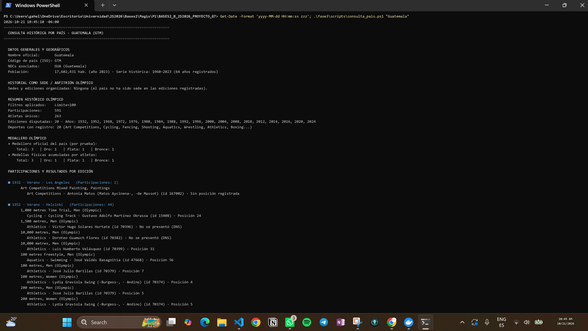

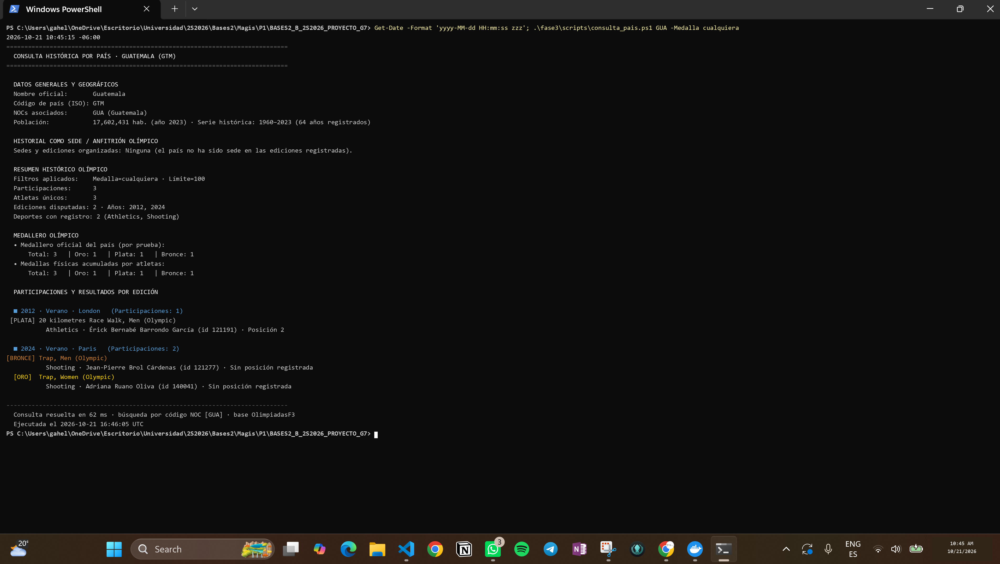

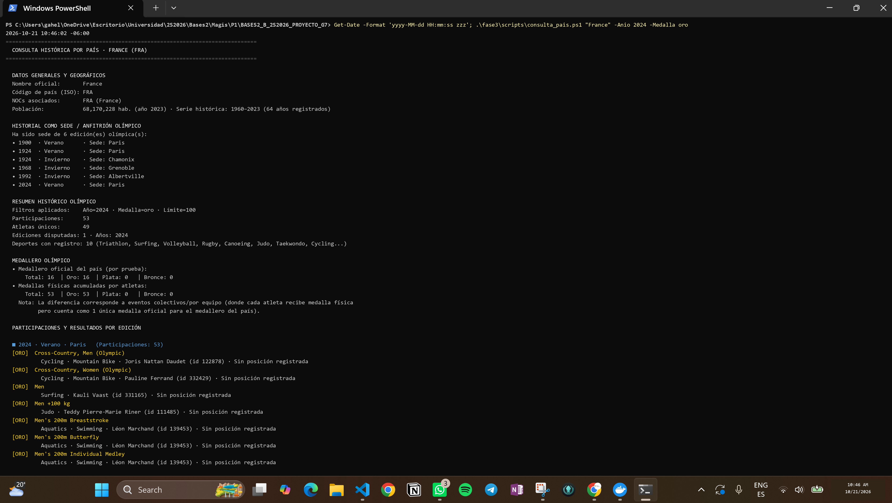

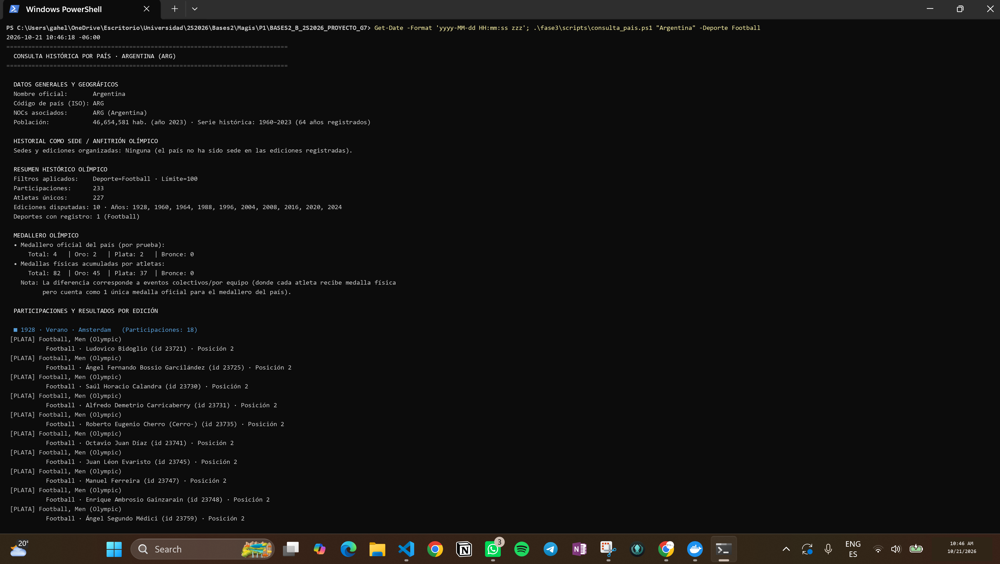

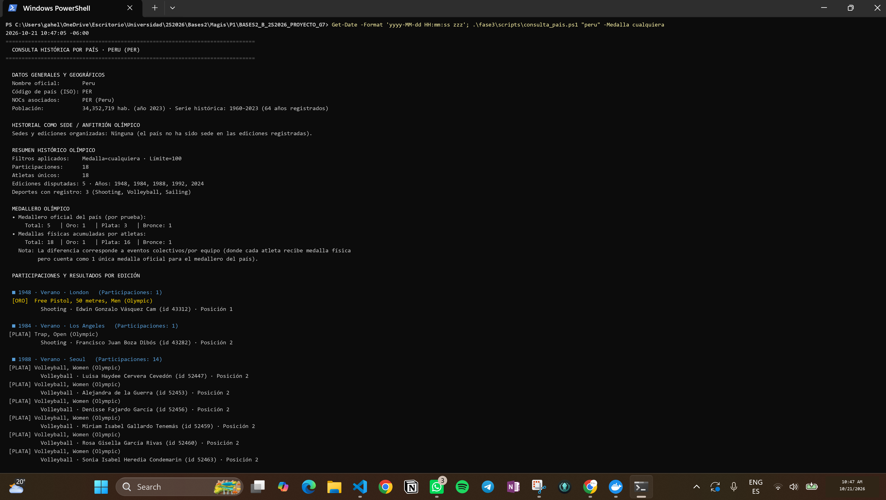

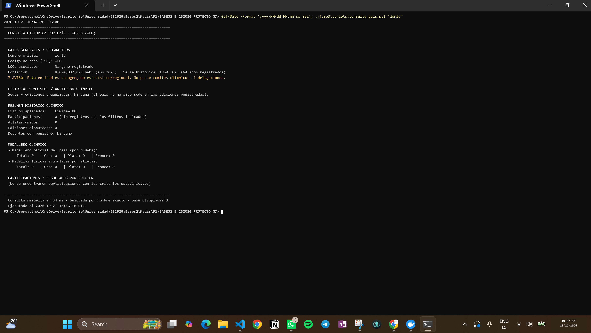

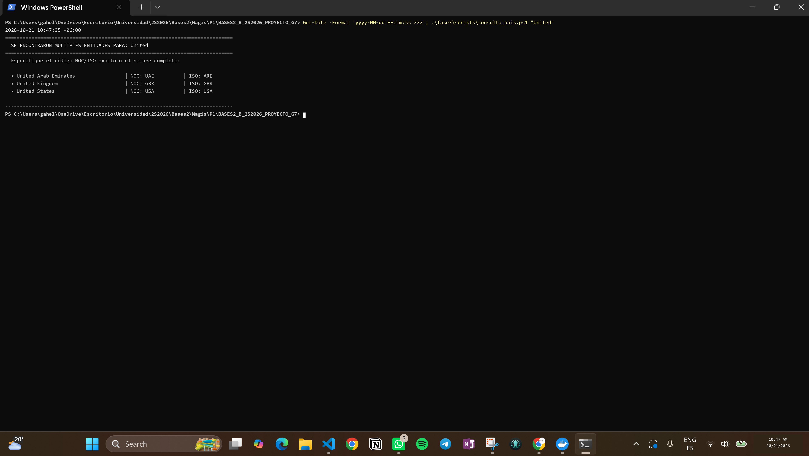

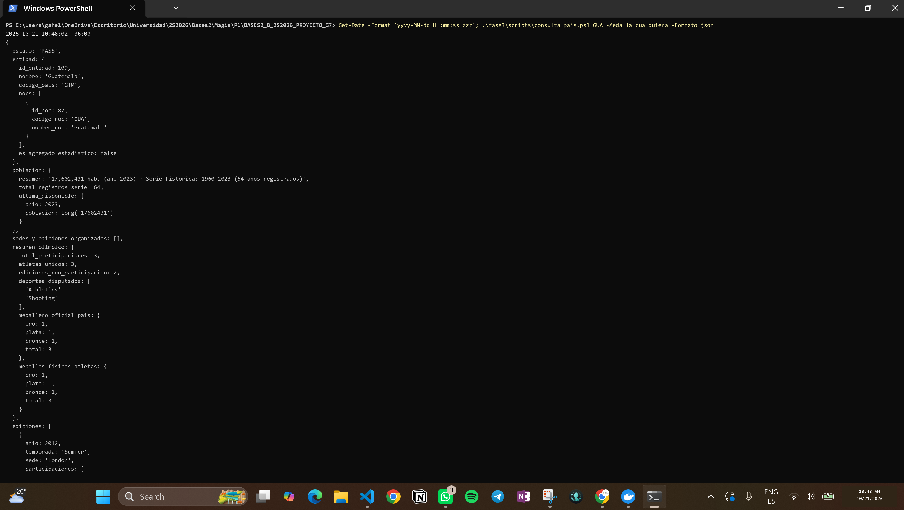

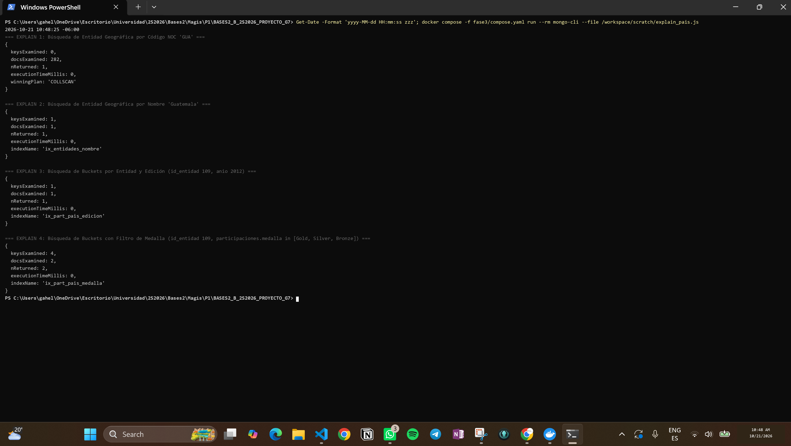

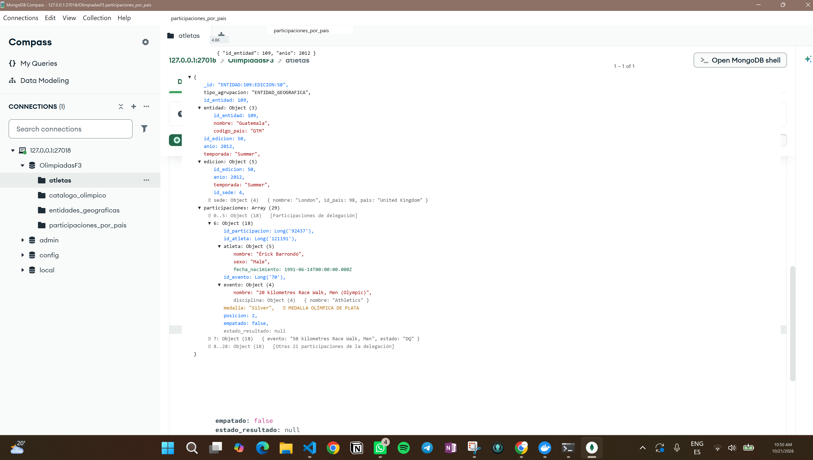

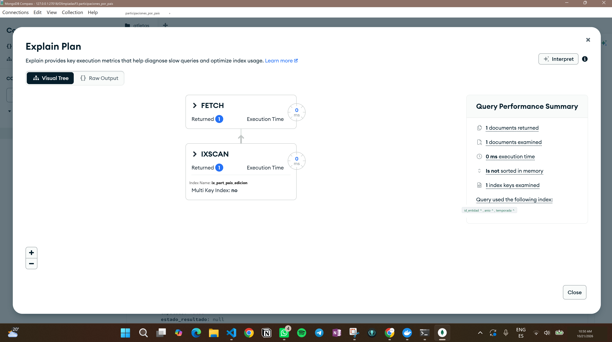

